# 简化精度：自适应容差——对照实验、参数依据与定稿回归

2026-11-25。回答一个问题：编辑器的"消除锯齿"应该用多大的容差，才能既去掉栅格掩膜边缘的锯齿，
又不改变图斑的形状和面积。结论先行，证据在后。

契约见 [矢量成果契约](vector-result-v1-contract.md) §6；上一轮（固定容差）的报告见
[定稿回归](geometry-engine-regression-20261124.md) 与 [简化方案对照实验](geometry-engine-simplify-ablation.md)。

## 0. 结论

- **固定容差 1e-5 度（约 1.1 米）不能用。** 它改动了 95% 的图斑，顶点压缩 82.8%，面积相对变化中位数 13.3%、
  95 分位 34%、最大 159%；贴矿山边界的图斑，贴边长度只保持 18%。
- **只用"像元的固定倍数"也不行。** 1 个像元时小图斑的面积变化中位数就有 2.4%、95 分位 12%、最大 60%；
  0.5 个像元以下压缩率又明显不够。
- **定稿：自适应容差加精度门槛。** 初始容差 `min(1 × 像元, 0.05 × √最小部件面积, 1 米)`；简化结果必须通过
  保存同款校验，并且每个部件的面积变化不超过 3%、对称差不超过 5%、部件数与孔数不变；不过关就把容差减半重试，
  最多四级；仍不过关就拒绝，原面保持不变。
- **全量生产成果上的结果**（3029 条成果、144,176 个图斑）：有变化 69.2%，原样 23.3%，拒绝 7.5%；
  有变化的图斑顶点压缩 56.6%；面积相对变化中位数 0.26%、95 分位 1.73%、最大 3.00%；
  贴边长度保持 64.75%。简化后的每一个结果都单独验证过：全部在 ROI 内、结构不变，面积变化没有一个超过门槛。

## 1. 问题

生产影像的像元从 0.019 米到 1.89 米不等（中位数 0.238 米）。固定容差对 0.2 米像元的成果太大（把真实的地物
边缘也抹掉了），对 1 米以上像元的成果又太小（锯齿还在）。而且不同大小的图斑对同一容差的耐受完全不同：
半径 3 米的小图斑，容差 1 米就是形状的巨变。

## 2. 先核实的事实

**像元从哪里读。** 读这条成果自己的 label 文件的头信息（`result.label_path`）。生产 3029 条可读成果里，
2930 条是 EPSG:4326、99 条是 EPSG:3857。另有 14 条成果的 label 文件缺失，这时回退到 0.1 米并记告警——
回退值取得小，是因为读不到像元时宁可少简化。

**用正确的物理单位，但不引入新的几何误差。** 生产镜像里没有 pyproj。量测用的是 rasterio 自带的
GDAL 3.10.3 / PROJ 9.7.1：把点变换到以本处为中心的等距方位投影（`+proj=aeqd`，从中心出发的径向距离等于椭球面上的真实距离），在那个平面里量
"每度多少米"和像元的真实米尺寸。**简化本身仍在 EPSG:4326 里做，顶点原样保留**，不在米制坐标系里重采样。
像元的真实尺寸按仿射变换、在栅格中心的纬度量（`pixel_size_metres`），只读头信息、不读像元。度空间的面积比值与米制的比值一致（抽样与 PROJ 等积投影对比，最大偏差 3.8e-5），所以精度门槛可以直接在度空间算。

Web Mercator 的像元尺寸不是地面尺寸：EPSG:3857 下名义 0.5 米的像元，在北纬 25.9° 的地面尺寸是 0.45 米。
按真实尺寸算，隔离演练里实测 `pixel_size_m` 报的是 0.4501。

**米换算成度用保守轴**：取经向、纬向"每度多少米"中较大的那个去除，得到的角距离只会偏小、不会偏大。

## 3. 候选与敏感性

考虑过的策略：固定米制容差、每像元固定倍数、按图斑面积、联合（取几者的最小值）。

在分层样本（253 条成果、12,547 个图斑）上，对每个图斑算出一系列容差下的原始简化候选（GEOS 拓扑保持简化，
按 ROI 规则判合法与否）。下表是"只用像元的固定倍数做容差"的结果，不加面积上限、不做重试：

| 容差 | 有变化且合法 | 无变化 | 越界或无效 | 面积相对变化 P50 / P95 / 最大 | 顶点压缩（中位） |
| --- | --- | --- | --- | --- | --- |
| 0.13 像元 | 16.8% | 76.9% | 6.3% | 0.02% / 0.5% / 4.8% | 3.8% |
| 0.25 像元 | 29.7% | 64.5% | 5.7% | 0.11% / 1.9% / 19.0% | 11.2% |
| 0.50 像元 | 70.8% | 23.8% | 5.3% | 0.10% / 3.9% / 31.7% | 29.1% |
| 1 像元 | 92.5% | 0.6% | 6.9% | 1.54% / 12.2% / 60.3% | 71.4% |
| 2 像元 | 91.9% | 0.3% | 7.9% | 4.84% / 24.1% / 69.3% | 82.8% |
| 4 像元 | 91.6% | 0.2% | 8.2% | 12.2% / 31.7% / 86.5% | 86.5% |

有变化的图斑，面积相对变化的中位数按图斑大小分（同一张表）：

| 容差 | <10 m² | 10–50 | 50–100 | 100–1k | 1k–10k | ≥10k |
| --- | --- | --- | --- | --- | --- | --- |
| 0.50 像元 | 0.12% | 0.12% | 0.11% | 0.07% | 0.04% | 0.02% |
| 1 像元 | 2.44% | 0.94% | 0.51% | 0.28% | 0.09% | 0.03% |
| 2 像元 | 7.64% | 2.76% | 1.85% | 0.80% | 0.32% | 0.06% |

读法：压缩率在 0.5 到 1 个像元之间跳变（29% → 71%），说明"去掉一个像元的锯齿"确实需要接近 1 个像元的容差；
但同样这个容差下，越小的图斑相对变形越大。所以上限取 1 个像元，同时按图斑自己的面积封顶，再用精度门槛兜底。

## 4. 定稿方案

```
初始容差（米） = min(1.0 × 像元, 0.05 × √最小部件面积, 1 米)
                 读不到像元时：0.1 米
各级容差       = 初始容差 × (1, 0.5, 0.25, 0.125)
```

对每一级容差：GEOS 拓扑保持简化（`preserve_topology=True`）→ 必须通过**与保存完全相同的权威校验**
（在成果原坐标系 EPSG:4326 内判定：几何有效、完全位于 ROI 内，数值容差 1e-9 度）→ 部件数与孔数不变
→ 精度门槛：**逐部件**面积相对变化 ≤ 3%、逐部件对称差 ≤ 5%。任一级通过即返回；都不通过则拒绝，原面保持不变。

| 结果 | 含义 |
| --- | --- |
| `changed` | 返回新几何，同时给出实际用的容差、面积变化、对称差 |
| `unchanged` | 起始容差下就没有顶点可去 |
| `rejected` | `OUTSIDE_ROI` / `INVALID_GEOMETRY` / `SHAPE_DRIFT`（面积或形态变化超限） |

接口同时返回 `mode`（自适应 / 显式容差）、`pixel_size_m`（像元的真实地面尺寸，读不到为空）。
显式传容差的请求走同一套精度门槛，容差必须在 (0, 1e-3] 度内。

这些常量有一项测试钉死在回归用过的值上（`test_parameters_are_pinned_to_the_ones_the_regression_ran_with`），
改动它们必须有新的回归依据。

**没有采用的做法**：D 方案（自定义边界保护，104 行几何逻辑，对照实验里被否决）、升级 Shapely / GEOS、
`coverage_simplify`（GEOS 把多数生产成果判为"不是有效 coverage"）。

## 5. 全量回归

**绑定**：被测代码 `11b82ef`（`geometry_engine.py`、`geometry_metric.py` 自该提交起未改动）；
数据为 2026-11-24 从生产只读导出的全部 ready 成果，`production-results.ndjson` 3030 行、
SHA256 `b75c9001…`；label 头信息实时只读读取；脚本 `adaptive_regression.py` SHA256 `01e02d4e…`；
运行时 python 3.10.20、Shapely 1.8.5.post1、GEOS 3.10.3-CAPI-1.16.1、rasterio 1.4.4、GDAL 3.10.3、PROJ 9.7.1；
镜像 `sha256:03b45aa8…`。复现：`bash backend/tools/geometry_engine_experiments/run_adaptive_regression.sh 11b82ef all 3`。

规模：3029 条成果、144,176 个图斑、21,990,431 个坐标位置；用时 392 秒，峰值内存 113 MB。

### 结果分布与精度

| 指标 | 新方案 | 现行方案（固定 1e-5 度） |
| --- | --- | --- |
| 有变化 / 原样 / 拒绝 | 69.2% / 23.3% / 7.5% | 95.05% / — / — |
| 拒绝的原因 | 越界 6,015；无效 0；形态超限 4,847 | — |
| 顶点压缩（全部 / 有变化的） | 37.9% / 56.6% | 82.8% |
| 面积相对变化 P50 / P90 / P95 / P99 / 最大 | 0.26% / 1.31% / 1.73% / 2.51% / 3.00% | 13.3% / — / 34.0% / — / 159% |
| 对称差 P50 / P95 / 最大 | 2.18% / 4.69% / 5.00% | — |
| 各级容差上通过的图斑数 | 68,475 / 28,559 / 1,963 / 779 | — |

### 按图斑大小

| 面积 | 有变化 | 原样 | 拒绝 |
| --- | --- | --- | --- |
| < 10 m² | 57.8% | 37.9% | 4.3% |
| 10–50 m² | 88.0% | | |
| 50–100 m² | 93.0% | | |
| 100–1,000 m² | 85.8% | | |
| 1,000–10,000 m² | 50.0% | | 49.8% |
| ≥ 10,000 m² | 13.0% | | 87.0% |

### 按图斑类型

| 类型 | 数量 | 有变化 |
| --- | --- | --- |
| 贴矿山边界 | 49,933 | 84.6%（贴边长度保持 64.75%；现行方案 18.4%） |
| MultiPolygon | 21 | 66.7% |
| 带孔 | — | 73.0% |
| 道路（细长） | — | 71.6% |
| 狭窄 | — | 91.4% |
| 超出保存上限的 | — | 41.7% |
| 人工编辑产生的 | — | 64.0% |

贴边的图斑，简化后边缘离矿山边界被拉开的距离：中位数 0.0998 米、99 分位 0.5735 米、最大 0.9992 米。

### 图斑之间

简化会让相邻图斑的公共边各自移动，产生新的重叠和空隙。两种方案各自简化一次之后的总量：

| 指标 | 简化前 | 现行方案 | 新方案 |
| --- | --- | --- | --- |
| 图斑间重叠面积 | 9,026 m² | 202,619 m²（+193,593） | 71,362 m²（+62,336） |
| 被图斑覆盖的面积 | 31,496,344 m² | 31,161,142 m²（−1.064%） | 31,426,190 m²（−0.223%） |
| 单条成果的覆盖变化（中位 / 最小） | — | −94 / −771 m² | −13 / −434 m² |

各地类的面积净变化在 −0.0075% 到 −0.11% 之间。新增的重叠约为现行方案的三分之一，但它不是零，见"已知限制"。

## 6. 确定性与重复简化

- **GEOS 的不确定性。** 上一轮查出 8 个图斑在同一输入上连算两次会得到不同结果。新方案下，全量数据连算两次
  0 / 144,176 不同；那 8 个图斑各连算 100 次，每个都只有 1 种输出。
- **接口不保证幂等。** 对已经简化过的结果再简化一次，5,074 个图斑（5.1%）还会变，累计面积变化最大 5.26%、
  对称差最大 9.0%；第三次 98 个，第四次 1 个，第五次 0 个。所以前端不重复提交上次简化返回、之后没改过的面。

## 7. 耗时

单图斑：中位 0.67 毫秒、95 分位 7.09、99 分位 40.3、最大 179.9 毫秒。一次请求带满 20 万个坐标位置的最坏情况
2.95 秒。隔离演练里 66–70 个面的一次简化，接口端到端 189–287 毫秒。

## 8. 对比图

每张图左面是整个图斑，右面是局部放大；灰色实线是原几何（点是原来的顶点），红色虚线是简化后。
坐标轴是米，放大图的网格是 label 的像元边界。

| 图 | 说明 |
| --- | --- |
| 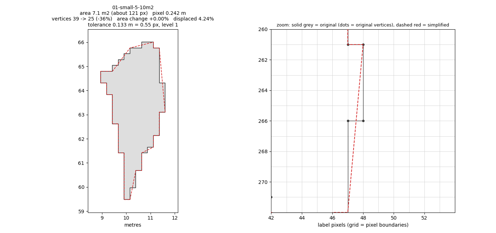 | 小图斑，面积 5–10 m² |
| 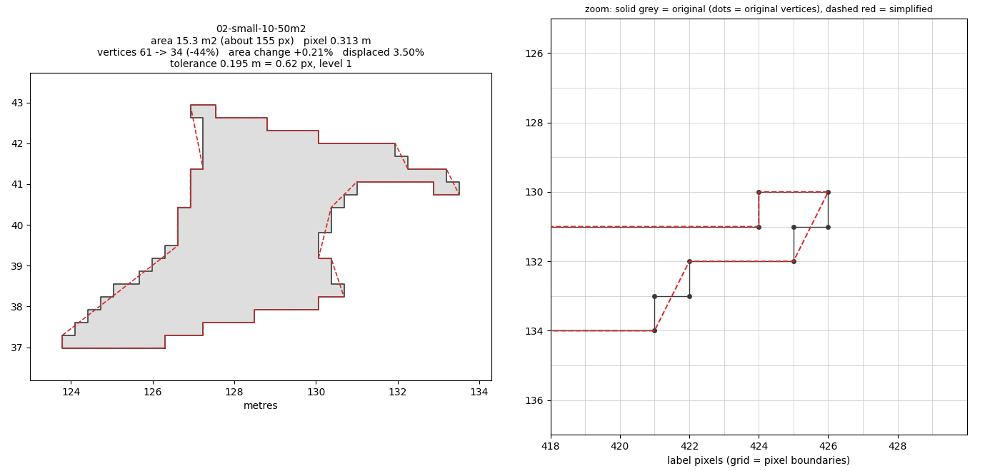 | 小图斑，面积 10–50 m² |
| 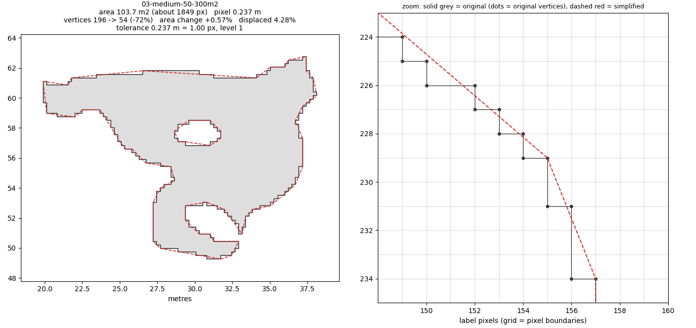 | 中等图斑，面积 50–300 m² |
| 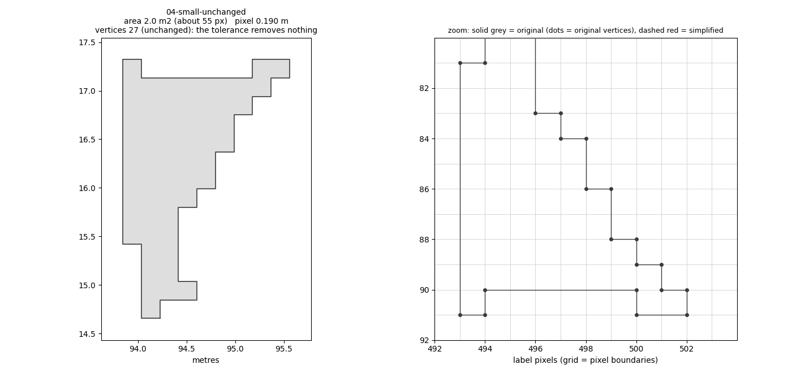 | 起始容差下没有顶点可去，保持原样 |
| 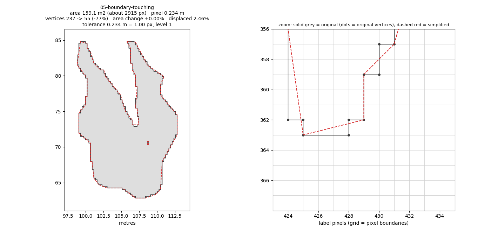 | 贴矿山边界的图斑：锯齿去掉，贴边的直段保持 |
| 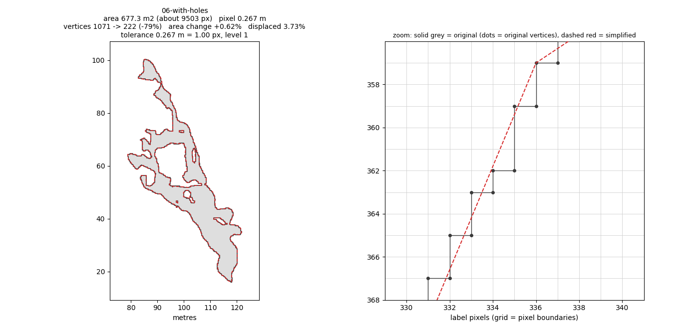 | 带孔的图斑 |
| 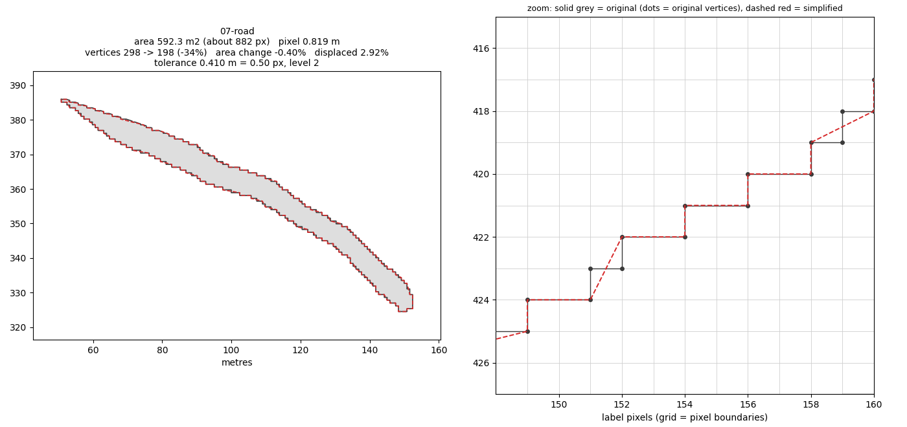 | 细长的道路 |
| 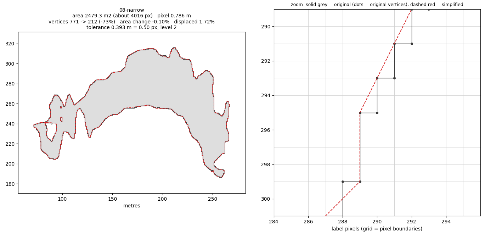 | 狭窄的图斑 |
| 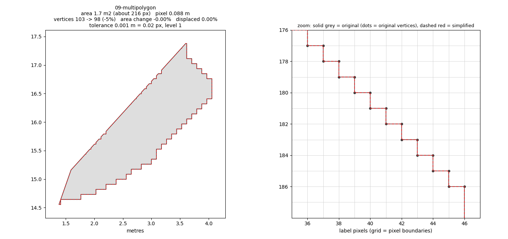 | MultiPolygon |
| 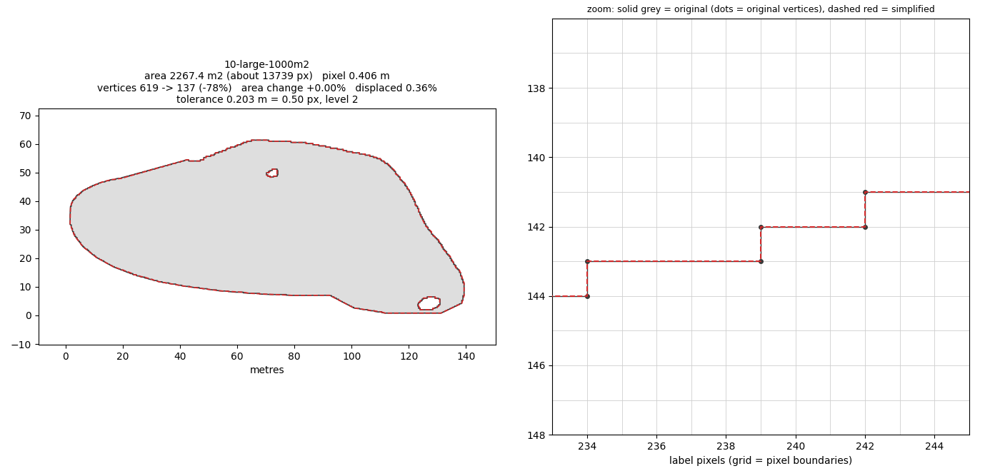 | 1000 m² 的大图斑 |
| 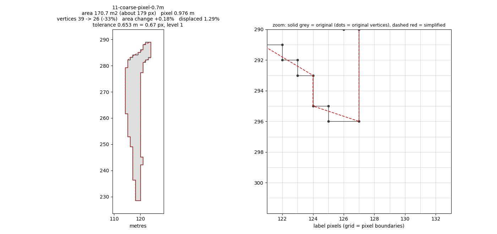 | 粗像元（0.7 米）的成果 |
| 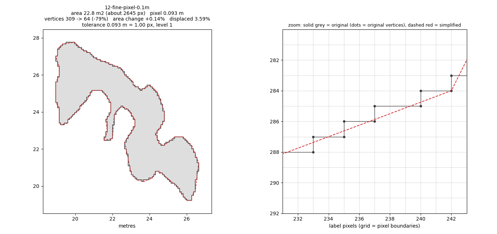 | 细像元（0.1 米）的成果 |
| 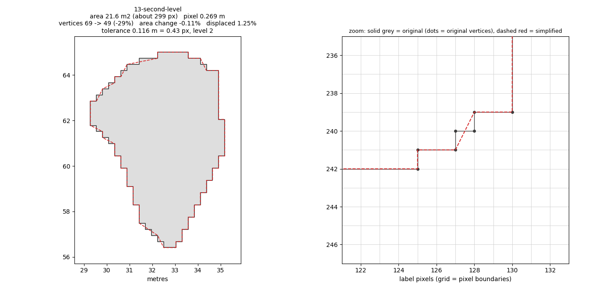 | 第一级没过精度门槛、第二级通过的图斑 |
| 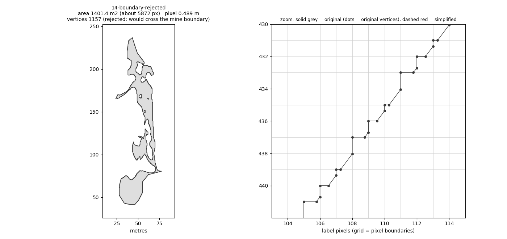 | 简化后会超出矿山边界，被拒绝，原面保持不变 |

## 9. 不依赖引擎代码的交叉验证

对 99,776 个"有变化"的结果，另写脚本独立复算：

- **改造前的保存规则**（原始的 ROI 判定表达式）全部通过，99,776 / 99,776。
- **结构与顶点**：部件数、孔数与原来一致，100%；返回的坐标都是原几何里已有的点。
- **面积**：用 PROJ 等积投影逐部件重量，没有一个超过 3% 的门槛（1 例因投影后环自相交无法计量）。
- **ROI 外的面积**：谓词判定全部在界内；叠加运算量出的界外残差合计 0.1206 m²，伸出边界的最大深度 0.0077 毫米
  ——这是浮点运算的残差（改用纯 Python 的射线法重算为 0）。

## 10. 已知限制

- **贴矿山边界的大图斑多数无法简化。** 1,000 m² 以上的图斑近一半被拒，10,000 m² 以上 87% 被拒：它们沿着
  矿山边界有很长的阶梯边，GEOS 的拓扑保持简化会把这条边移到界外，只能逐级降容差直到不动。
- **MultiPolygon 共用一个容差**，按最小部件的面积封顶，大部件会因此简化得偏保守。
- **新增的图斑间重叠不是零**（+62,336 m²，约为现行方案的三分之一）。相邻图斑的公共边是各自简化的，
  本方案不保证它们仍然重合。
- **14 条成果读不到 label**，用 0.1 米回退；其中像元实际较大的成果会简化得偏轻。
- **像元尺寸假设整幅 label 一致**：按仿射变换、在栅格中心量一个值。
